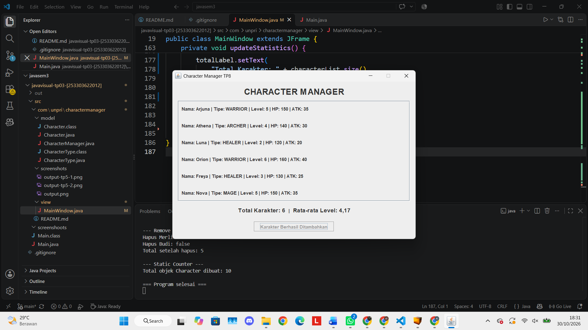
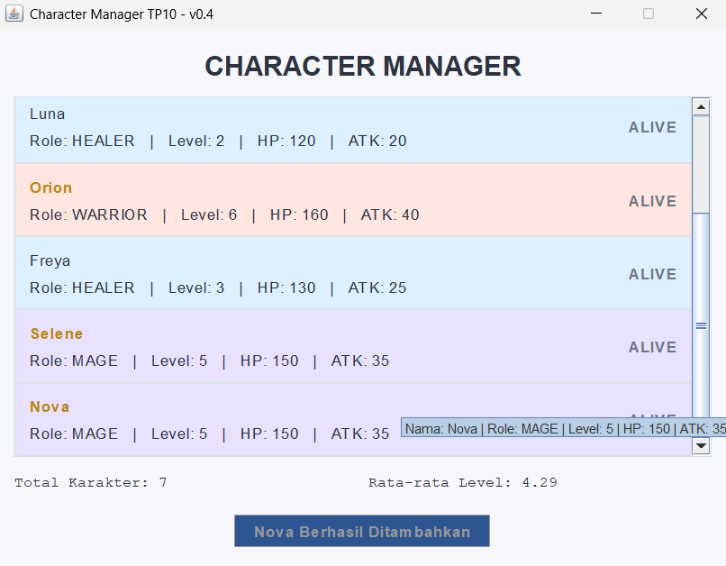
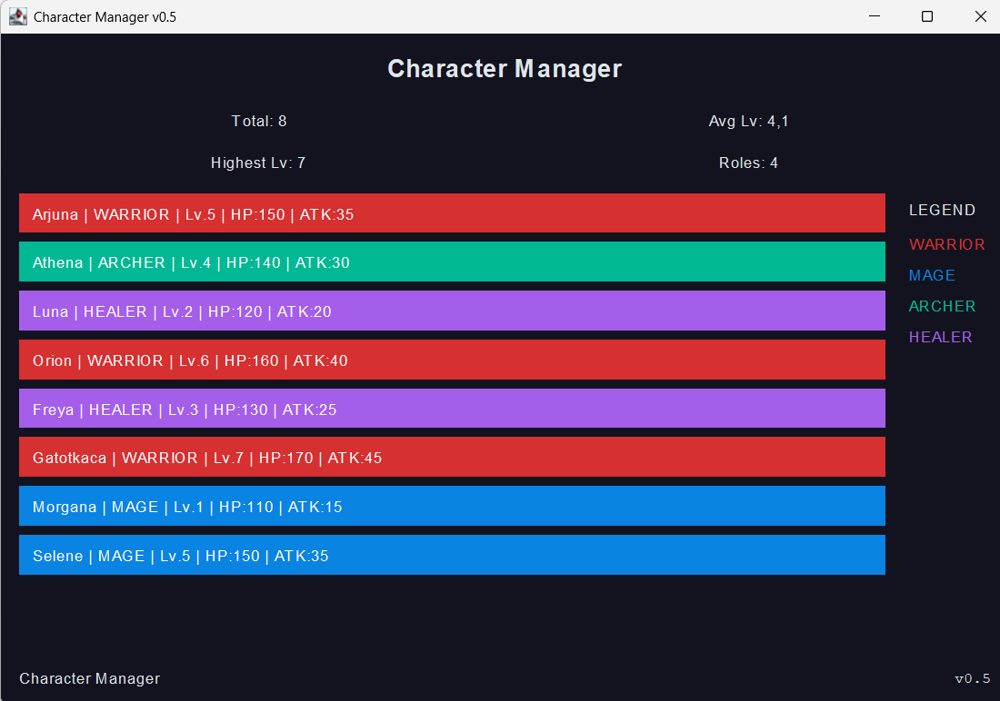
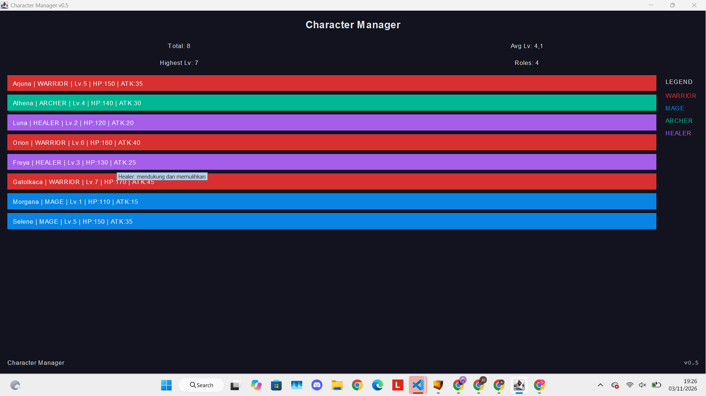
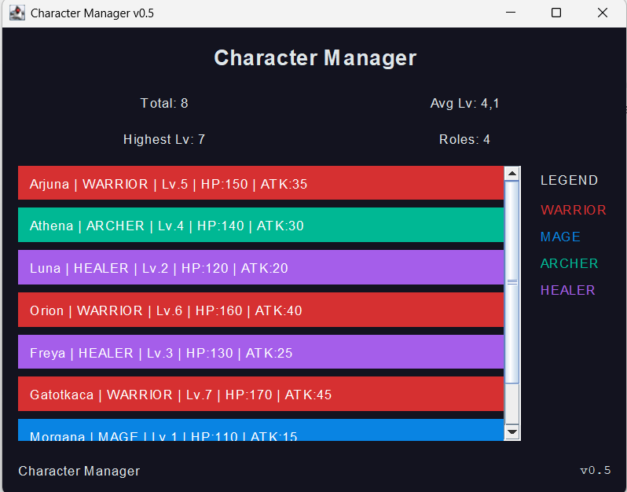

# Character Manager — Java Visual SIH-6406

Aplikasi Character Manager merupakan aplikasi Java sederhana untuk mengelola karakter game menggunakan konsep Object-Oriented Programming (OOP), Java Swing, dan arsitektur Model-View.

**Nama:** Dhaifullah Al Hafizh Zuldiansyah  
**NIM:** 253303622012  
**Kelas:** SI Pagi A

---

## TP3 — Implementasi OOP

### Deskripsi

Character Manager adalah aplikasi Java sederhana yang dirancang untuk mengelola karakter dalam game menggunakan konsep Pemrograman Berorientasi Objek (Object-Oriented Programming/OOP). Aplikasi ini menerapkan penggunaan class, constructor, enkapsulasi, getter dan setter, serta enum untuk menentukan jenis karakter.

Aplikasi memiliki atribut karakter seperti level, poin kesehatan (HP), kekuatan serangan (attack power), dan mana. Selain itu, terdapat method `isAlive()` untuk memeriksa apakah karakter masih hidup.

### Screenshot Output

Screenshot berikut menampilkan hasil keluaran program pada terminal, termasuk hasil pemanggilan method `isAlive()`.


### Identitas Mahasiswa

**Nama:** Dhaifullah Al Hafizh Zuldiansyah  
**NIM:** 253303622012  
**Kelas:** SI Pagi A

---

## TP5 — CharacterManager

### A. Implementasi Core

Fitur yang telah diimplementasikan dan diuji:

- `equals()` membandingkan karakter berdasarkan nama.
- `addCharacter()` menambahkan karakter dan menolak nama duplikat.
- `findByName()` mencari karakter berdasarkan nama.
- `removeCharacter()` menghapus karakter berdasarkan nama.
- `getTotalCharacters()` menghitung jumlah karakter yang tersimpan.
- `getAllCharacters()` mengembalikan salinan daftar karakter.

Pengujian menunjukkan empat karakter berhasil ditambahkan, sedangkan penambahan karakter dengan nama Arjuna yang sudah ada ditolak.

### B. Mini-Challenge

- `getAverageLevel()` menghitung rata-rata level karakter dan mengembalikan `0` ketika daftar kosong.
- `findByType(CharacterType type)` mengembalikan daftar karakter berdasarkan tipe yang dipilih.

Hasil pengujian menunjukkan rata-rata level empat karakter adalah `3.5`. Pencarian berdasarkan tipe WARRIOR menghasilkan Arjuna, sedangkan tipe MAGE menghasilkan Merlin.

### C. Fitur Tambahan: findStrongest()

Saya menambahkan method `findStrongest()` untuk mencari karakter dengan attack power tertinggi. Method ini melakukan pemeriksaan terhadap seluruh karakter yang tersimpan, kemudian mengembalikan karakter dengan nilai attack power paling tinggi. Fitur ini membantu mengetahui karakter dengan kekuatan serangan terbesar tanpa harus membandingkan setiap karakter secara manual.

---

## TP8 — Implementasi GUI Character Manager

### Screenshot Aplikasi

**Tampilan awal (5 karakter):**


**Tampilan setelah menambahkan karakter Nova:**


### Penjelasan Alur Data dan MVC

Pada program ini, `Main` membuat objek `CharacterManager` dan menambahkan beberapa karakter ke dalamnya. Selanjutnya, data karakter diambil menggunakan `getAllCharacters()` dan nilai rata-rata level diperoleh melalui `getAverageLevel()`. Kedua data tersebut diteruskan ke `MainWindow` untuk ditampilkan menggunakan komponen GUI Swing, termasuk daftar karakter dan statistik rata-rata level.

Ketika tombol tambah karakter ditekan, karakter Nova ditambahkan ke daftar karakter dan statistik diperbarui secara otomatis.

Dalam konsep MVC, class `Character` dan `CharacterManager` berperan sebagai Model karena mengelola data karakter. Class `MainWindow` berperan sebagai View karena menampilkan data kepada pengguna. Sementara itu, `Main` mengatur proses awal pembuatan data dan menampilkan jendela aplikasi.

### Karakter Tambahan

1. **Orion** — tipe WARRIOR, level 6. Ditambahkan sebagai karakter petarung dengan level tinggi.
2. **Freya** — tipe HEALER, level 3. Ditambahkan sebagai karakter pendukung.
3. **Nova** — tipe MAGE, level 5. Ditambahkan melalui tombol pada GUI untuk menunjukkan perubahan daftar karakter dan statistik secara dinamis.

### Analisis TP8

Google Docs — Analisis TP8

---

## TP10 — AppTheme & MainWindow v0.4

### A. Implementasi Tema

Pada TP10, aplikasi Character Manager dikembangkan dengan menggunakan class `AppTheme` untuk mengatur warna, font, dan border agar tampilan lebih konsisten.

Class `AppTheme` berada di package `view` dan memiliki beberapa konstanta warna, font, serta border yang digunakan oleh `MainWindow`. Method `colorFor(CharacterType type)` digunakan untuk menentukan warna kartu berdasarkan role karakter.

Implementasi ini membuat pengaturan tampilan lebih terpusat dan tidak perlu ditulis berulang kali pada setiap komponen.

### B. Screenshot Aplikasi

**Before — MainWindow v0.3**



**After — MainWindow v0.4**



### C. Mini-Challenge

Karakter dengan level minimal 5 ditampilkan menggunakan tulisan berwarna emas dan tebal. Batas level disimpan dalam konstanta bernama `GOLD_LEVEL_THRESHOLD` sehingga nilainya dapat diatur tanpa harus mengubah banyak bagian kode.

Aplikasi juga menampilkan minimal enam karakter dengan variasi role dan level yang berbeda.

### D. Implementasi AppTheme

Warna tampilan aplikasi disimpan di dalam class `AppTheme` karena pengaturan warna merupakan bagian dari tampilan atau View. Dengan cara ini, warna tidak perlu disimpan di class `Character` yang bertugas mengelola data karakter. Pemisahan tersebut membuat kode lebih terstruktur dan memudahkan perubahan tema tanpa mengubah Model. Selain itu, penggunaan `AppTheme` memungkinkan warna yang sama digunakan kembali oleh beberapa komponen aplikasi.

### E. Properti Tambahan

**1. Tooltip Informasi Karakter**

Setiap kartu karakter memiliki tooltip yang menampilkan informasi seperti nama, role, level, HP, ATK, dan mana. Fitur ini membantu pengguna melihat detail karakter tanpa membuat tampilan utama terlalu penuh.

**2. Karakter Level 1 Dinonaktifkan**

Karakter yang masih berada di level 1 dibuat nonaktif menggunakan `setEnabled(false)`. Fitur ini memberikan pembeda visual dan menunjukkan bahwa karakter tersebut memiliki kondisi khusus dibandingkan karakter lainnya.

### F. Analisis Bagian D — Google Docs

[JavaVisual TP10 — Analisis Properti & MVC](https://docs.google.com/document/d/1YduyrsfJwi4Mmx1Gu_p91PJkxbL1m5sxPvg8nv3zS0M/edit?usp=sharing)

Dokumen tersebut berisi analisis mengenai JavaBeans getter/setter, properti background JLabel, pengaturan ukuran komponen Swing, pemisahan Model dan View, serta penggunaan logical font dan `deriveFont()`.


```markdown
---

## TP12 — Implementasi Layout & Resize

### A. Implementasi Layout

Pada TP12, `MainWindow` dikembangkan menjadi versi v0.5 dengan menggunakan `BorderLayout` sebagai layout utama. Aplikasi dibagi menjadi empat wilayah, yaitu `NORTH` untuk header dan statistik, `CENTER` untuk daftar karakter, `EAST` untuk legenda role, dan `SOUTH` untuk status bar.

Daftar karakter ditempatkan di dalam `JScrollPane`. Kartu karakter terlebih dahulu ditambahkan ke panel khusus, kemudian panel tersebut dimasukkan ke dalam `JScrollPane`. Cara ini membuat daftar karakter dapat digulir ketika ukuran jendela terlalu kecil.

Legenda menggunakan `BoxLayout` dengan arah `Y_AXIS`. Isi legenda dibuat berdasarkan `CharacterType.values()` sehingga seluruh role yang tersedia pada Model dapat ditampilkan tanpa menuliskan role satu per satu secara manual. `Box.createVerticalStrut()` digunakan untuk memberikan jarak antar elemen, sedangkan `Box.createVerticalGlue()` membantu menjaga susunan legenda tetap rapi.

Tidak digunakan `setLayout(null)` maupun `setBounds()` pada `MainWindow`. Pengaturan warna dan font juga tetap menggunakan `AppTheme`, sehingga kode layout tidak memiliki nilai warna atau font yang ditulis secara hardcode. Package `model` tidak diubah pada TP12.

### B. Panel Tambahan

Sebagai perluasan dari layout sebelumnya, ditambahkan panel statistik pada bagian `NORTH`. Panel tersebut menggunakan `GridLayout(2, 2)` sehingga empat informasi statistik dapat disusun dalam empat bagian dengan ukuran yang seimbang.

Informasi yang ditampilkan adalah jumlah karakter, rata-rata level, level tertinggi, dan jumlah role. `GridLayout` dipilih karena setiap informasi memiliki tingkat kepentingan yang sama dan cocok ditampilkan dalam susunan baris dan kolom yang teratur.

`FlowLayout` tidak dipilih untuk panel statistik karena FlowLayout lebih cocok untuk komponen yang disusun secara berurutan dalam satu baris, sedangkan statistik pada aplikasi ini lebih mudah dibaca jika dibagi menjadi empat bagian.

### C. Status Bar

Status bar ditempatkan pada bagian `SOUTH` menggunakan `BorderLayout`. Teks `"Character Manager"` berada di sebelah kiri, sedangkan versi aplikasi `"v0.5"` berada di sebelah kanan.

### D. Karakter

Aplikasi menampilkan minimal delapan karakter dengan variasi level dan role sebagai berikut:

| Nama | Role | Level |
|---|---|---:|
| Arjuna | WARRIOR | 5 |
| Athena | ARCHER | 4 |
| Luna | HEALER | 2 |
| Orion | WARRIOR | 6 |
| Freya | HEALER | 3 |
| Gatotkaca | WARRIOR | 7 |
| Morgana | MAGE | 1 |
| Selene | MAGE | 5 |

Data karakter tetap dikelola oleh Model, sedangkan `MainWindow` hanya membaca data menggunakan getter untuk menampilkannya.

### E. Struktur Panel Bersarang

Struktur utama aplikasi menggunakan `BorderLayout` pada `mainPanel`. Bagian `NORTH` berisi panel header yang memiliki judul dan panel statistik dengan `GridLayout`. Bagian `CENTER` berisi `JScrollPane` yang membungkus panel kartu karakter, sedangkan bagian `EAST` berisi panel legenda dengan `BoxLayout`. Bagian `SOUTH` digunakan sebagai status bar dengan `BorderLayout` agar teks aplikasi dapat berada di kiri dan versi berada di kanan.

### F. Wireframe

Struktur layout aplikasi dapat digambarkan sebagai berikut:

```text
+-------------------------------------------------------------+
|                      HEADER                                 |
|                 Character Manager                           |
|                                                             |
|       +----------------+----------------+                   |
|       | Total          | Average Level  |                   |
|       +----------------+----------------+                   |
|       | Highest Level  | Roles          |                   |
|       +----------------+----------------+                   |
+---------------------------------------------+---------------+
|                                             |               |
|              DAFTAR KARAKTER               |    LEGEND     |
|                                             |               |
|  Arjuna | WARRIOR | Lv.5 | HP | ATK        | WARRIOR       |
|  Athena | ARCHER  | Lv.4 | HP | ATK        | MAGE          |
|  Luna   | HEALER  | Lv.2 | HP | ATK        | ARCHER        |
|  Orion  | WARRIOR | Lv.6 | HP | ATK        | HEALER        |
|  ...                                        |               |
|                                             |               |
|              [ Scrollbar ]                  |               |
+---------------------------------------------+---------------+
| Character Manager                                      v0.5 |
+-------------------------------------------------------------+
```

### G. Screenshot Resize

### G. Screenshot Resize








## H. Tabel Prediksi dan Hasil Resize

| Kondisi Jendela | Prediksi Sebelum Pengujian | Hasil Setelah Pengujian |
|---|---|---|
| Ukuran Awal | Komponen ditampilkan sesuai pembagian area BorderLayout. | Seluruh komponen tampil, termasuk delapan kartu karakter, panel statistik, legenda, dan status bar. |
| Jendela Dilebarkan | Area CENTER akan mendapatkan ruang lebih luas, sedangkan legenda tetap berada di sebelah kanan. | Tampilan melebar dan area daftar karakter mendapatkan ruang lebih besar. |
| Jendela Dikecilkan | Area CENTER akan menyesuaikan ukuran dan JScrollPane menyediakan scrollbar jika konten tidak muat. | Scrollbar vertikal muncul sehingga daftar karakter tetap dapat diakses. |

### I. Analisis Layout & MVC

Google Docs — Analisis TP12

[JavaVisual TP12 — Analisis Layout & MVC](https://docs.google.com/document/d/12BvOLGWMB7nRJHvVgYGQ4Jr5PluIiFxGWWTeSLaWKg8/edit?usp=sharing)

Dokumen tersebut berisi analisis mengenai penggunaan Layout Manager, preferred size, BorderLayout, GridLayout, BoxLayout, JScrollPane, pemisahan Model dan View, serta penggunaan `revalidate()` dan `repaint()`.
```

Jadi **jangan mengganti README kamu dengan teks di atas**. Cukup **tambahkan section TP12 tersebut** ke README yang sudah ada.

Ada satu hal penting: nama screenshot seperti `tp12_awal.png`, `tp12_lebar.png`, dan `tp12_kecil.png` **belum perlu kamu buat sekarang**. Nanti setelah GUI berhasil jalan, kita ambil 3 screenshot tersebut dan baru kita sesuaikan path-nya.

Dan untuk link Google Docs, **jangan pakai link TP10 yang lama**. Nanti kita buat/siapkan khusus untuk TP12.

---

## Struktur Folder Project


javavisual-tp03-[253303622012]/
│
├── src/
│   ├── Main.java
│   └── com/
│       └── unpri/
│           └── charactermanager/
│               ├── model/
│               │   ├── Character.java
│               │   ├── CharacterManager.java
│               │   └── CharacterType.java
│               │
│               ├── view/
│               │   ├── AppTheme.java
│               │   └── MainWindow.java
│               │
│               └── screenshots/
│                   ├── before-v03.png
│                   └── after-v04.png
│
├── screenshots/
│   ├── output.png
│   ├── TP8-sebelum.png
│   └── TP8-sesudah.png
│
└── README.md

