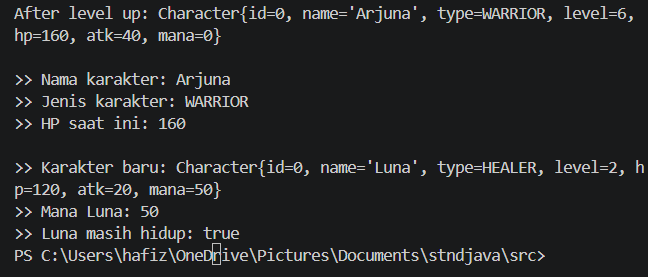

# Character Manager — TP3 (Java Visual SIH-6406)

## Deskripsi

Character Manager adalah aplikasi Java sederhana yang dirancang untuk mengelola karakter dalam game menggunakan konsep Pemrograman Berorientasi Objek (Object-Oriented Programming/OOP). Aplikasi ini menerapkan penggunaan class, constructor, enkapsulasi, getter dan setter, serta enum untuk menentukan jenis karakter. Aplikasi ini juga memiliki atribut karakter seperti level, poin kesehatan (HP), kekuatan serangan (attack power), dan mana, serta method untuk memeriksa apakah karakter masih hidup.

## Screenshot Output

Screenshot berikut menampilkan hasil keluaran program pada terminal, termasuk hasil pemanggilan method `isAlive()` untuk memeriksa apakah karakter masih hidup.



## Struktur Folder Project

```text
CharacterManager/
├── src/
│   └── com/
│       └── unpri/
│           └── charactermanager/
│               ├── model/
│               │   ├── Character.java
│               │   └── CharacterType.java
│               └── Main.java
├── screenshots/
│   └── output.png
└── README.md
```

## Identitas Mahasiswa

- **Nama Lengkap:** [Dhaifullah Al Hafizh Zuldiasnyah]
- **NIM:** [253303622012]
- **Google Docs (Bagian D):** [https://docs.google.com/document/d/1YduyrsfJwi4Mmx1Gu_p91PJkxbL1m5sxPvg8nv3zS0M/edit?usp=sharing]

# Character Manager — TP3 & TP5 (Java Visual SIH-6406)

## Deskripsi

Character Manager adalah aplikasi Java sederhana yang dirancang untuk mengelola karakter dalam game menggunakan konsep Pemrograman Berorientasi Objek (Object-Oriented Programming/OOP). Aplikasi ini menerapkan class, constructor, enkapsulasi, getter dan setter, serta enum untuk menentukan jenis karakter.

Aplikasi memiliki atribut karakter seperti level, poin kesehatan (HP), kekuatan serangan (attack power), dan mana. Aplikasi juga menerapkan pengelolaan karakter melalui `CharacterManager`.

## Screenshot Output TP3

Screenshot berikut menampilkan hasil keluaran program TP3, termasuk pengujian method `isAlive()`.


## Struktur Folder Project

```text
javavisual-tp03-[253303622012]/
├── src/
│   ├── com/unpri/charactermanager/model/
│   │   ├── Character.java
│   │   ├── CharacterType.java
│   │   └── CharacterManager.java
│   └── Main.java
├── screenshots/
└── README.md
```

## Identitas Mahasiswa

- **Nama Lengkap:** Dhaifullah Al Hafizh Zuldiasnyah
- **NIM:** 253303622012
- **Kelas:** SIH-6406

---

# TP5 — CharacterManager

## A. Implementasi Core

Fitur yang telah diimplementasikan dan diuji:

- `equals()` membandingkan karakter berdasarkan nama.
- `addCharacter()` menambahkan karakter dan menolak nama duplikat.
- `findByName()` mencari karakter berdasarkan nama.
- `removeCharacter()` menghapus karakter berdasarkan nama.
- `getTotalCharacters()` menghitung jumlah karakter yang tersimpan.
- `getAllCharacters()` mengembalikan salinan daftar karakter.

Pengujian menunjukkan empat karakter berhasil ditambahkan, sedangkan penambahan karakter dengan nama Arjuna yang sudah ada ditolak.

## B. Mini-Challenge

- `getAverageLevel()` menghitung rata-rata level karakter dan mengembalikan `0` ketika daftar kosong.
- `findByType(CharacterType type)` mengembalikan daftar karakter berdasarkan tipe yang dipilih.

Hasil pengujian menunjukkan rata-rata level empat karakter adalah `3.5`. Pencarian berdasarkan tipe WARRIOR menghasilkan Arjuna, sedangkan tipe MAGE menghasilkan Merlin.

## C. Fitur Tambahan: findStrongest()

Saya menambahkan method `findStrongest()` untuk mencari karakter dengan attack power tertinggi. Method ini meng

## TP8 - Implementasi GUI Character Manager

### Screenshot Aplikasi

**Tampilan awal (5 karakter):**


**Tampilan setelah menambahkan karakter Nova:**


### Penjelasan Alur Data dan MVC

Pada program ini, `Main` membuat objek `CharacterManager` dan menambahkan beberapa karakter ke dalamnya. Selanjutnya, data karakter diambil menggunakan `getAllCharacters()` dan nilai rata-rata level diperoleh melalui `getAverageLevel()`. Kedua data tersebut diteruskan ke `MainWindow` untuk ditampilkan menggunakan komponen GUI Swing, termasuk daftar karakter dan statistik rata-rata level. Ketika tombol tambah karakter ditekan, karakter Nova ditambahkan ke daftar pada tampilan dan statistik diperbarui secara otomatis.

Dalam konsep MVC, class `Character` dan `CharacterManager` berperan sebagai Model karena mengelola data karakter. Class `MainWindow` berperan sebagai View karena menampilkan data kepada pengguna. Sementara itu, `Main` mengatur proses awal pembuatan data dan menampilkan jendela aplikasi.

### Karakter Tambahan

1. **Orion** — tipe WARRIOR, level 6. Ditambahkan sebagai karakter petarung dengan level tinggi.
2. **Freya** — tipe HEALER, level 3. Ditambahkan sebagai karakter pendukung yang memiliki kemampuan penyembuhan.
3. **Nova** — tipe MAGE, level 5. Ditambahkan melalui tombol pada GUI untuk menunjukkan perubahan daftar karakter dan statistik secara dinamis.

### Analisis TP8

[Google Docs - Analisis TP8](GANTI_DENGAN_LINK_GOOGLE_DOCS)